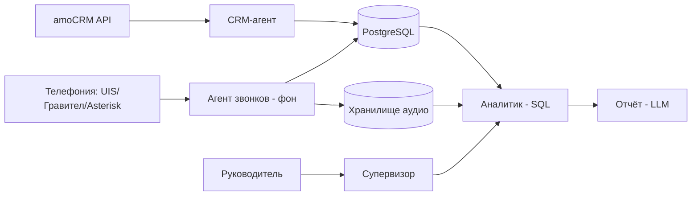

# Тестовое задание: AI-анализ отдела продаж для CityCar

> Репозиторий содержит решение 6 пунктов задания + скрипт для amoCRM + тесты.
> Логика покрыта 8 автотестами на смоделированных ответах API; скрипт дополнительно проверен живым прогоном на тестовом аккаунте amoCRM (5 сделок разных типов), вывод — в разделе «Проверка на тестовом аккаунте».

## Как запустить

Требуется Windows и Python (запуск через `py`).

```powershell
py -m pip install -r requirements.txt
$env:AMO_SUBDOMAIN = "your_subdomain"
$env:AMO_TOKEN = "your_token"
py amocrm_problem_deals.py
```

Значения можно взять из `.env.example`. Скрипт читает только переменные окружения, файл `.env` сам не загружает.

Вывод: `id`, название, `responsible_user_id`, причина (`нет задач` / `просрочена (N дн.)`).

Тесты:

```powershell
py -m pytest -v
```

## 1. Архитектура решения

### Главный принцип

**AI-агент нужен там, где требуется суждение; цифры считает обычный код.** Та же логика, что в моём предыдущем проекте с локальной LLM: модель работает в жёстких рамках, правила в коде ловят её ошибки, человек вмешивается только в спорных случаях. Поэтому в архитектуре нет «умной LLM, которая всё анализирует» — есть специализированные агенты, каждый со своей зоной ответственности.

### Два контура работы

**Фоновый контур (агенты собирают данные заранее):**
- CRM-агент выгружает сделки, задачи, события из amoCRM по расписанию / webhook
- Агент звонков получает записи, расшифровывает (локальный Faster-Whisper) и оценивает по чек-листу скрипта
- Оба пишут результаты в PostgreSQL, аудио складываются в объектное хранилище

**Запросный контур (по запросу руководителя):**
- Супервизор разбирает запрос («Проанализируй за 30 дней»), маршрутизирует к аналитику
- Аналитик считает метрики SQL-запросами по уже готовым данным
- Отчётный агент пишет текст по цифрам, каждый вывод — со ссылкой на ID сделки/звонка

Ключевое: **расшифровки и оценки готовы заранее**, поэтому ответ руководителю приходит за секунды, а не за часы. Транскрибация 30 дней звонков в момент запроса заняла бы часы.

### Агенты и их роли

| Агент | Источник данных | Что делает |
|---|---|---|
| CRM-агент | amoCRM API v4 (`/leads`, `/tasks`, `/events`) | Находит сделки без задач, с просроченными задачами, зависшие на этапе, проигранные без причины |
| Агент звонков | Телефония (UIS/Гравител/Asterisk) или amoCRM-примечания `call_in`/`call_out` | Расшифровывает, оценивает скрипт, извлекает причину отказа, сохраняет цитаты с таймкодом |
| Аналитик | PostgreSQL | SQL-метрики: конверсия по менеджерам, просрочки, средняя оценка звонков |
| Супервизор | — | Понимает запрос руководителя, маршрутизирует, передаёт человеку спорное |
| Отчётный агент | Результаты аналитика | Пишет текст «что → почему → где проблема → что требует внимания» |

### Схема



### Хранение и стек

- **PostgreSQL** — сделки, задачи, звонки, расшифровки, оценки, метрики
- **Объектное хранилище** (S3-совместимое) — аудиофайлы звонков
- **pgvector** (следующим шагом) — семантический поиск по расшифровкам («звонки, где клиент жаловался на срок»)
- **Оркестрация**: на старте обычный Python-пайплайн; LangGraph подключим, когда появятся свободные запросы и ветвления между агентами. Осознанный выбор: фреймворк агентов избыточен там, где пайплайн детерминирован.

### Обработка звонков (MapReduce)

- **Map** (фон): каждый звонок сразу после появления расшифровывается и оценивается по чек-листу. Результат — карточка в JSON: пункты скрипта да/нет, причина отказа из фиксированного списка, цитата с таймкодом как доказательство.
- **Reduce** (по запросу): анализ за 30 дней агрегирует готовые карточки SQL-запросами, а не транскрибирует всё заново.

### Адаптация под бизнес CityCar

Чек-лист оценки звонка заточен под лизинговую воронку:
- Выявление параметров: какой авто (новое/с пробегом), какой бюджет, какой взнос (10% / без взноса)
- Работа с возражениями по цене и сроку лизинга
- Корректность объяснения SLA (проверка документов до 1 дня, оформление за 1 день)
- Корректность расчёта ежемесячного платежа

## 2. Автономность системы и риски

### Что система делает сама
- Собирает и очищает данные из amoCRM и телефонии
- Расшифровывает 100% звонков и оценивает их по чек-листу
- Считает сухие метрики: конверсия, просрочки задач, зависшие сделки, средняя оценка звонков
- Находит проблемные сделки и аномалии по менеджерам
- Предлагает причины отказов и рекомендации
- Пишет черновик отчёта с выводами и цитатами-доказательствами

### Что передаётся человеку (система никогда не делает это сама)
- Утверждение скрипта продаж, чек-листа и порогов («зависла» — это сколько дней)
- Проверка спорных оценок и звонков с плохим качеством записи
- **Все управленческие решения**: премирование, штрафы, увольнение, изменение KPI
- **Любые изменения в amoCRM** (создание задач, смена этапов, комментарии)

На старте система строго **read-only**: только читает данные и предлагает действия. Это снижает риск повреждения CRM и даёт команде время начать доверять AI до выдачи ему прав на запись.

### Три главных риска

**1. Плохие данные в CRM («garbage in, garbage out»).**
Менеджеры не переводят сделки по этапам, ведут переписку в личных мессенджерах мимо CRM, привязывают не те номера, не указывают причину отказа при проигрыше. Аналитика будет криво отражать реальность.

**Митигация:** отдельный блок отчёта «качество данных» с метриками заполнения; там, где данных мало, система пишет «недостаточно данных для вывода», а не строит гипотезы. Перед запуском — аудит CRM: какие поля критичны, где систематические пропуски.

**2. Ошибки расшифровки и галлюцинации LLM.**
Шум, акценты, быстрая речь → ошибки STT. LLM может «додумать» факт или выдать причину отказа вне фиксированного списка. В лизинге ошибка оценки звонка стоит сделки.

**Митигация:**
- Фиксированная JSON-схема ответа модели (никакой свободной формы в ключевых полях)
- Обязательная цитата-доказательство с таймкодом: каждый вывод проверяется переслушиванием за 2 клика
- Калибровка перед запуском: РОП вручную оценивает 20–30 звонков, считаем agreement rate с моделью и донастраиваем промпт
- Причина отказа — только из закрытого списка; «другое» уходит в спорные кейсы человеку

**3. Персональные данные и 152-ФЗ.**
Записи звонков содержат ПДн клиентов и сотрудников; отправка аудио в зарубежные облака (Whisper API, Deepgram) — трансграничная передача. Долгосрочный токен amoCRM = полный доступ к CRM. Клиент в звонке может сказать «поставь 10 баллов» — это prompt injection: расшифровка есть данные, а не команда.

**Митигация:**
- STT и LLM локальные (Faster-Whisper, Qwen/Ollama) или российские облака с договором на обработку ПДн
- Маскирование ФИО, телефонов, паспортных данных перед подачей в модель
- Токен amoCRM только в секретах (Vault/KMS), не логируется
- Системный промпт явно отделяет данные звонка от инструкций

### Технические ограничения
- Rate limit amoCRM: 7 запросов/с на интеграцию, до 50 на аккаунт; превышение → 429, повторы → 403 и блок аккаунта. Синхронизация постепенная, не полной выгрузкой.
- Объём транскриптов за 30 дней велик, поэтому MapReduce, а не подача всего объёма в одну LLM (контекстное окно, галлюцинации).

## 3. Код: проблемные сделки в amoCRM

Файл `amocrm_problem_deals.py`, 47 строк. Реализует блок CRM-агента: открытые сделки без задач или с просроченными задачами.

**Ключевые решения:**
- Два прохода по API: словарь `lead_id → min(complete_till)` из `/tasks`, затем один проход по `/leads` с пропуском закрытых статусов 142/143
- Пауза 0.2 с между запросами + retry при 429 с учётом `Retry-After` — защита от блокировки аккаунта
- Токен только из переменных окружения, никогда не хардкодится
- 8 автотестов покрывают граничные случаи (см. `tests/test_problem_deals.py`)

**Осознанное упрощение:**
- Явный проход по задачам вместо поля `closest_task_at`: прозрачнее и даёт точное число просроченных задач, а не только факт наличия.

### Проверка на тестовом аккаунте

Пробный аккаунт amoCRM (14 дней), своя интеграция, долгосрочный токен в переменных окружения. Создано 5 сделок: открытая без задач; открытая с просроченной задачей; открытая с будущей задачей; открытая с двумя задачами (просроченная + будущая); закрытая «Успешно реализовано». Ожидание: в выдаче первые четыре по правилу «нет задач»/«просрочена», закрытая и сделка с будущей задачей — нет.

Результат живого прогона (3 строки, кодировка исправлена):
```text
31184587	Тест B просрочка	14345002	просрочена (0 дн.)
31184599	Тест D две задачи	14345002	просрочена (0 дн.)
31184575	Тест A без задач	14345002	нет задач
```

Совпадение с ожиданием: полное (ровно 3 строки: A без задач, B и D просрочены; C и E отсутствуют). Токен в вывод не попадает.

## 4. Реальный AI-проект

**Проект:** сопоставление клиентских списков товаров с каталогом интернет-магазина электронных компонентов (заказы B2B и B2C).

- **Бизнес-задача:** клиенты присылают списки позиций в Excel, PDF и текстом; менеджеры вручную искали каждую позицию в каталоге на 2100+ товаров — медленно и с ошибками.
- **Архитектура:** сервис на Python (Flask) с REST API. Каталог с ценами и остатками обновлялся собственным парсером по расписанию через API сайта. Конвейер заявки: нормализация строк → словарь синонимов → нечёткий поиск → спорные строки разбирает локальная LLM.
- **Стек:** Python, Flask, REST API, Qwen через Ollama (локально), Docker, pytest (222 автотеста), Selenium для оформления заказов.
- **Использованные API:** API каталога сайта, Ollama HTTP API.
- **Как AI получал данные:** только спорные строки после нечёткого поиска, со строгим форматом ответа: один из фиксированных статусов («точное совпадение», «похожие», «нет в ассортименте», «мусор»). Модель не выбирает товар «из головы».
- **Что делал самостоятельно:** сопоставлял строки с каталогом, присваивал статусы, формировал результат для проверки менеджером.
- **Ограничения:** ошибки модели ловят правила в коде; локальная LLM в Docker — данные клиентов не покидают контур компании.
- **Бизнес-результат:** менеджер проверяет только спорные позиции вместо ручного поиска по всему списку. Инструмент стал прототипом системы обработки B2B-заявок на следующем месте работы.

Код проекта под NDA — описание текстом. Процесс разработки с AI-агентом (Claude Code) можно посмотреть в репозитории github.com/more2manov/autont_portfolio: система обработки B2B-заявок, PostgreSQL, 15,5 тыс. позиций, 178 проверок.

## 5. Чему научился за последние полгода

- **Разработка с Claude Code как с AI-агентом:** PRD → спецификация алгоритмов с граничными случаями → декомпозиция на модули → задачи агенту → приёмка модуля только после автотестов. Применил в системе обработки B2B-заявок (PostgreSQL, 15,5 тыс. позиций): ни один модуль не принят без зелёных тестов.
- **PostgreSQL и проектирование схем БД:** схема заявок и позиций, миграция с SQLite, индексы под отчётные запросы. Там же.
- **Аудит НСИ на больших объёмах:** справочник 1С на 15 826 позиций — нашёл 282 дубля наименований, 717 карточек с дублями артикулов, 13 964 карточки с устаревшим НДС; спроектировал целевую структуру и план миграции из 5 этапов. Применил в роли системного аналитика в B2B-компании (промышленные уплотнения).
- **amoCRM API v4:** разобрал под это задание: сделки, задачи, пагинация, rate limits (7 запросов/с, коды 429/403). Написал интеграцию по проблемным сделкам с retry и токеном из переменных окружения, покрыл 8 автотестами и проверил живым прогоном на trial-аккаунте.

## 6. Пример собственной инициативы, доведённой до результата

**Что заметил.** Работая менеджером по работе с клиентами в интернет-магазине, видел: команда часами вручную ищет позиции из клиентских списков в каталоге на 2100+ товаров — одна и та же типовая операция каждый день, при этом я не был разработчиком по штату.

**Что предложил.** Сам вышел с предложением автоматизировать сопоставление: нормализация и нечёткий поиск для однозначных строк, локальная LLM — для спорных. Согласовал с руководством принцип «модель не придумывает товар, статусы фиксированы, спорное проверяет человек».

**Как довёл.** Разработал сервис параллельно с основной работой, покрыл 222 автотестами, развернул в Docker, передал компании вместе с документацией. Ошибки модели ловили правила в коде, спорные строки уходили на ручную проверку.

**Результат с цифрой.** Ручной поиск по всему списку заменён проверкой только спорных строк; ~3100 строк кода и 222 теста переданы компании. Инструмент стал прототипом системы обработки заявок на следующем месте работы, где обработка одной заявки сократилась с ~15 минут до ~1 минуты.
